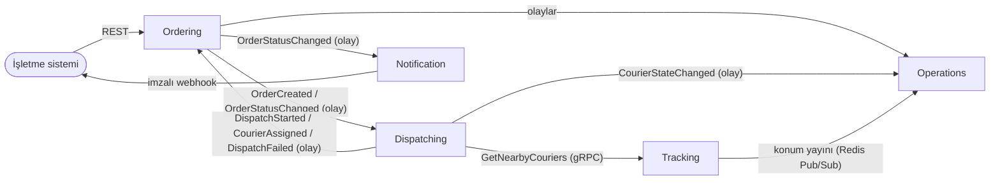
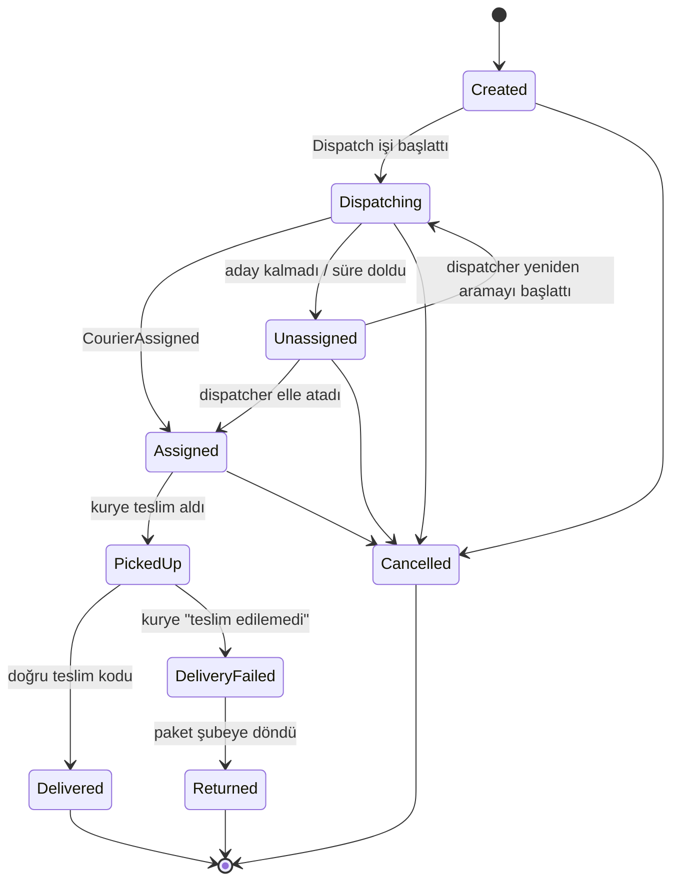
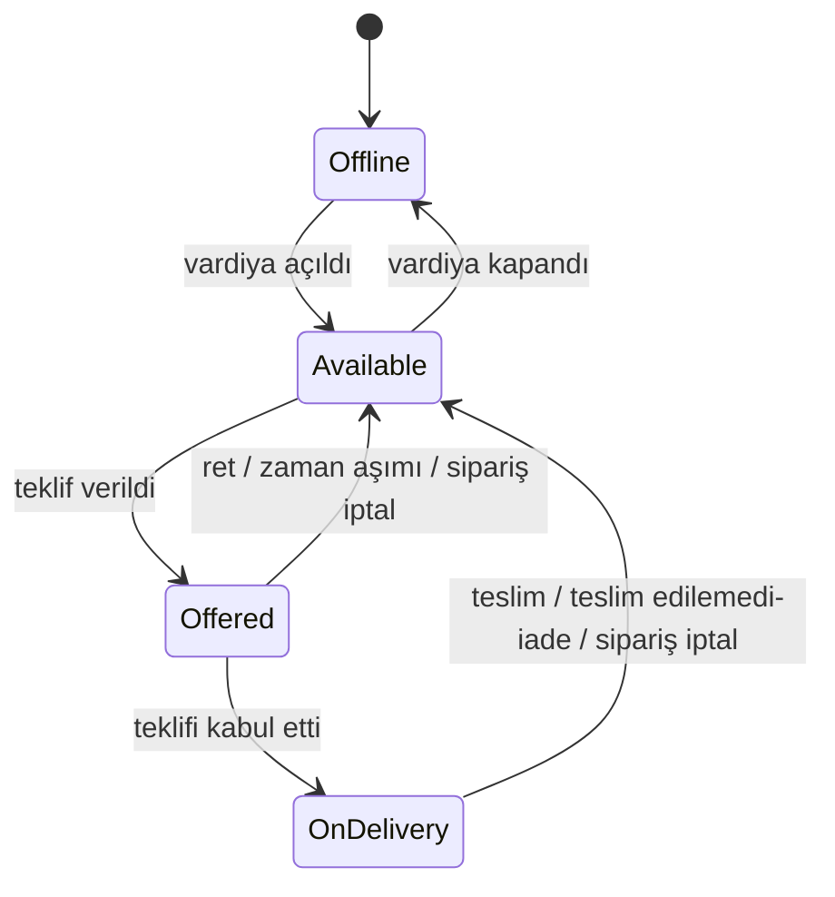

# 02 — Domain ve Bounded Context analizi

## 1. Bounded context'ler

**Bounded context:** Bir kavramın tek ve net bir anlamı olduğu sınır. Örneğin "kurye" Dispatch için *müsaitlik durumu olan bir kaynak*, Tracking için *hareket eden bir nokta*dır. Aynı kelime, farklı model.

| Context | Sorduğu soru | Servis | Tür |
|---|---|---|---|
| **Ordering** | "Bu sipariş hangi aşamada, kim neye yetkili?" | Orders | Core domain |
| **Dispatching** | "Bu siparişi kim götürmeli, kurye müsait mi?" | Dispatch | Core domain (projenin kalbi) |
| **Tracking** | "Kurye şu an nerede, yakınımda kim var?" | Tracking | Supporting |
| **Notification** | "İşletmeye haber verildi mi?" | Notifications | Generic |
| **Operations (okuma)** | "Bütün resmi tek ekranda göster" | Ops API | Okuma modeli (CQRS okuma tarafı) |
| **Identity** | "Bu kim, rolü ne?" | Keycloak | Generic (hazır ürün) |

## 2. Context haritası

- **Yayınlanmış dil (published language):** Context'ler birbirine iç modellerini değil, sürümlü olayları (`OrderCreated.v1`) ve proto sözleşmelerini açar.
- **Ordering ↔ Dispatching** karşılıklı olaylarla konuşur; ikisi de diğerinin iç durumunu bilmez. Orders, atanmış kurye bilgisini `CourierAssigned` olayından kendi tablosuna kopyalar.

## 3. Ortak dil (ubiquitous language)

| Türkçe | Kodda | Anlamı |
|---|---|---|
| İşletme | `Merchant` | Sipariş gönderen müşteri firma (makine istemcisi) |
| Sipariş | `Order` | Bir alış noktasından bir teslim noktasına taşınacak paket |
| Alış noktası | `Pickup` | Kuryenin paketi aldığı yer (şube) |
| Teslim noktası | `Dropoff` | Son müşterinin adresi |
| Kurye | `Courier` | Teslimatı yapan kişi |
| Vardiya | `Shift` | Kuryenin iş almaya açık olduğu zaman aralığı |
| Atama süreci | `DispatchJob` | Bir sipariş için kurye arama sürecinin kaydı |
| Teklif | `Offer` | Belirli bir kuryeye, belirli süreyle sunulan iş |
| Aday | `Candidate` | Yakında olan ve teklif verilebilecek kurye |
| Atama | `Assignment` | Kuryenin teklifi kabul etmesiyle siparişin ona bağlanması |
| Teslim kodu | `DeliveryCode` | Müşterinin kuryeye söylediği 4 haneli kanıt kodu |
| Konum noktası | `LocationPoint` | Kuryeden gelen tek konum ölçümü (`seq` sıra numarasıyla) |
| Takip token'ı | `TrackingToken` | Müşterinin tek bir siparişi izlemesine izin veren imzalı, süreli anahtar |
| Webhook teslimi | `WebhookDelivery` | Bir olayın bir işletmeye gönderim denemeleri kaydı |

## 4. Aggregate'ler

**Aggregate:** Birlikte tutarlı kalması gereken ve tek bir transaction'da değişen nesne kümesi. Dışarıdan yalnızca kökü (root) üzerinden değiştirilir.

| Aggregate | Context | İçerik | Neden bu sınır? |
|---|---|---|---|
| `Order` | Ordering | durum, noktalar, teslim kodu (hash + deneme sayısı), atanmış kurye, durum geçmişi | Sipariş kuralları (iptal, teslim) yalnızca sipariş verisine bakar |
| `Courier` | Dispatching | vardiya durumu, aktif teklif, aktif sipariş | "Kurye aynı anda tek iş" kuralı burada korunur |
| `DispatchJob` | Dispatching | sipariş için deneme sayısı, son deneme zamanı, durum | Bir siparişin atama süreci kuryeden bağımsız ilerler |
| `Offer` | Dispatching | kurye, sipariş, durum, son geçerlilik zamanı | Kabul/zaman aşımı yarışı tek satırda çözülür |

> Teklif oluşturma `Courier` (Available → Offered) ve `Offer` (yeni kayıt) değişikliklerini **aynı transaction'da** yapar. İkisi aynı servisin aynı veritabanında olduğu için bu güvenlidir; servisler arası transaction yoktur.

## 5. Durum makineleri

### 5.1 Sipariş (`OrderStatus`)

**Geçiş tablosu dışındaki her istek → 409 `invalid-order-transition`.** Özellikle:
- `PickedUp`, `Delivered`, `DeliveryFailed`, `Returned` durumunda iptal → 409.
- `Delivered` siparişe ikinci teslim → 409.
- `Cancelled` siparişe gelen `CourierAssigned` olayı → yok sayılır (log + metrik), hata değildir.

### 5.2 Kurye (`CourierState`)

- `OnDelivery` veya `Offered` iken vardiya kapatılamaz → 409.
- Konumu 30 sn'den eski olan `Available` kurye aday sayılmaz (Tracking bu kuryeyi "yakındakiler" sonucuna koymaz). Durumu `Offline`'a çekilmez; konum gelmeye başlayınca yine aday olur.

### 5.3 Teklif (`OfferStatus`)

`Pending → Accepted | Rejected | Expired | Cancelled`

- Kabul: `status = 'Pending' AND expires_at > @now` koşuluyla.
- Zaman aşımı işi: `status = 'Pending' AND expires_at <= @now` koşuluyla.
- Bu iki koşul birbirini dışladığı için **aynı teklif hem kabul hem zaman aşımı olamaz**; yarışı kaybeden taraf 0 satır günceller.

### 5.4 Atama süreci (`DispatchJobStatus`)

`Searching → Offering → Completed | Unassigned | Cancelled`

## 6. Değişmez kurallar (invariant)

| # | Kural | Nerede korunur? |
|---|---|---|
| I-1 | Bir kuryenin aynı anda en fazla bir `Pending` teklifi ve bir aktif siparişi olur. | Dispatch: koşullu update `WHERE state = 'Available'` |
| I-2 | Bir siparişin aynı anda en fazla bir `Pending` teklifi olur. | Dispatch: kısmi unique indeks `offers(order_id) WHERE status='Pending'` |
| I-3 | Bir sipariş en fazla bir kez `Assigned` olur (elle atama hariç yeniden atama yok). | Orders: durum makinesi + `xmin` |
| I-4 | Sipariş durumu yalnızca tablodaki geçişlerle değişir. | Orders domain (`Order.TransitionTo`) |
| I-5 | Teslim kodu düz metin saklanmaz; 5 yanlış denemeden sonra kilitlenir. | Orders domain |
| I-6 | Aynı `(merchant_id, Idempotency-Key)` en fazla bir sipariş üretir. | Orders: PK kısıtı |
| I-7 | Aynı olay bir tüketici tarafından en fazla bir kez işlenir. | Her servis: `inbox_messages` PK |
| I-8 | Kuryenin anlık konumu sıra numarası (`seq`) geriye gitmez. | Tracking: Redis'te son `seq` karşılaştırması |
| I-9 | Müşteri yalnızca kendi siparişinin kuryesini, yalnızca `Assigned`–`PickedUp` arasında görür. | Ops API: token + durum kontrolü |

## 7. Domain olayı ve entegrasyon olayı farkı

- **Domain olayı:** Servisin içinde, aynı süreçte kalan "şu oldu" bildirimi (ör. `Order` durum değiştirdi → durum geçmişine satır ekle). Dışarı çıkmaz.
- **Entegrasyon olayı:** Outbox ile RabbitMQ'ya yazılan, sürümlü, başka servislerin bağımlı olduğu sözleşme (`OrderCreated.v1`). Değiştirmek pahalıdır; bu yüzden `Rota.Contracts` projesinde ayrı tutulur ve iç modelle aynı sınıf **değildir**.
