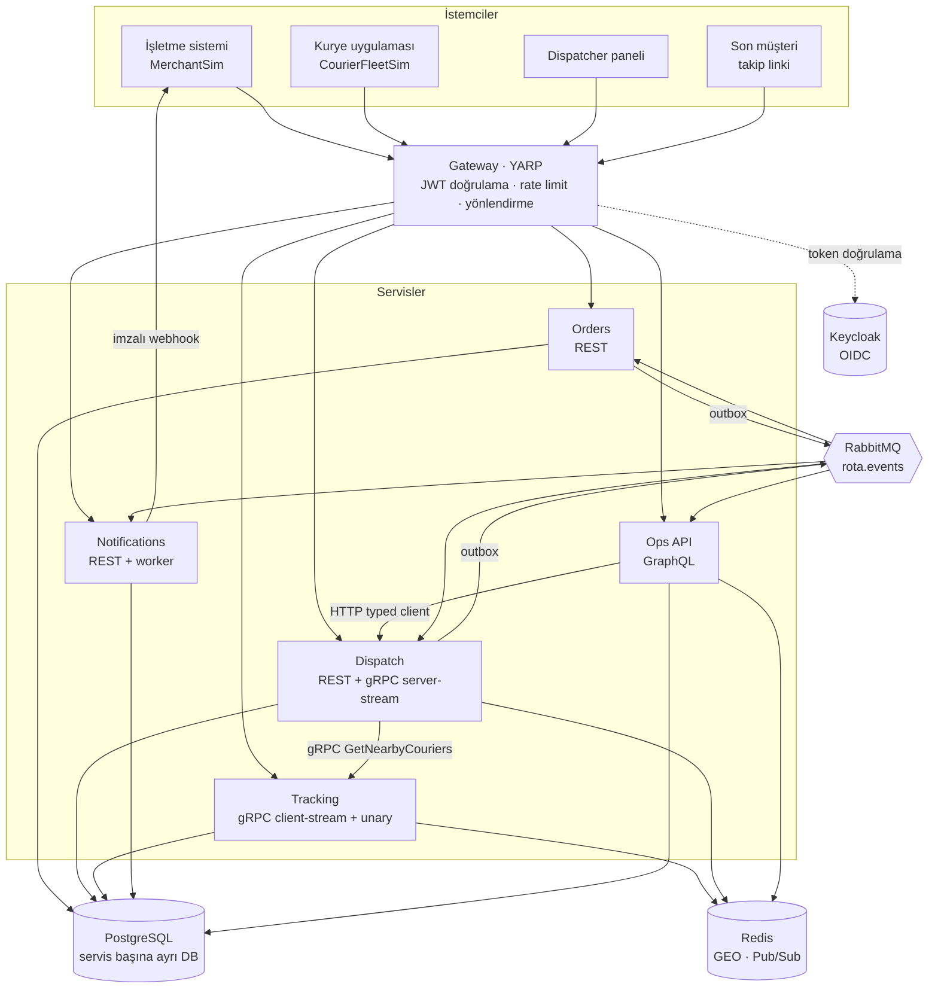
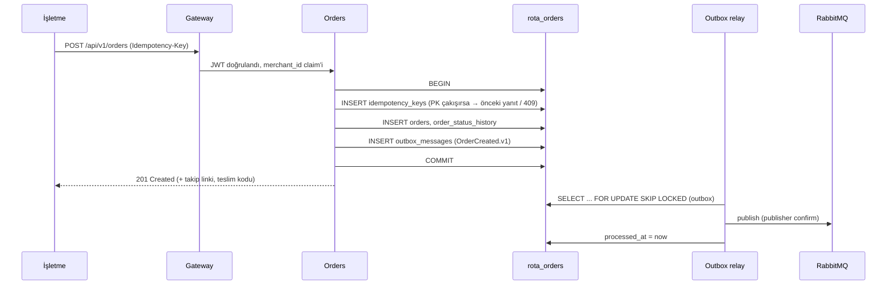
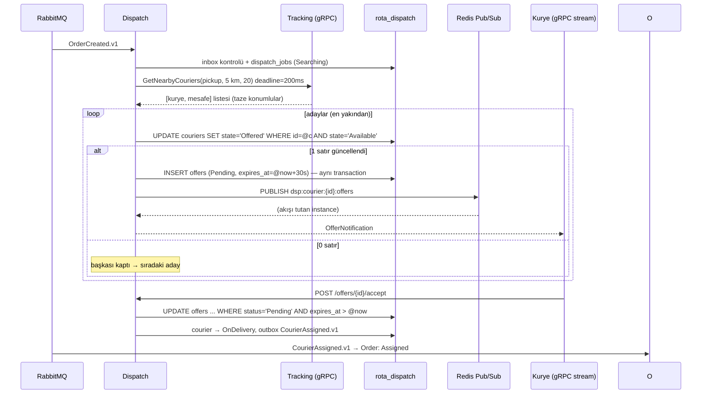
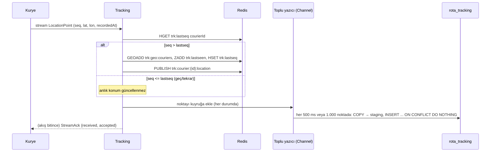
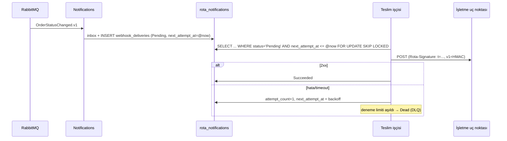

# 03 — Sistem mimarisi

## 1. Genel görünüm



## 2. Servisler ve sorumluluklar

| Servis | Proje | Sorumluluk | Dış arayüz | Veri |
|---|---|---|---|---|
| Gateway | `Rota.Gateway` | Tek giriş; JWT doğrulama; rate limit; yönlendirme; korelasyon | HTTP/1.1, HTTP/2 (gRPC proxy), WebSocket | — |
| Orders | `Rota.Orders.Api` | Sipariş yaşam döngüsü, teslim kodu, takip token'ı üretimi | REST | `rota_orders` |
| Dispatch | `Rota.Dispatch.Api` | Kurye vardiyası, aday seçimi, teklif, zaman aşımı, elle atama | REST + gRPC server-streaming (teklif akışı) | `rota_dispatch` + Redis Pub/Sub kanalı |
| Tracking | `Rota.Tracking.Api` | Konum alma, anlık konum indeksi, yakındaki kuryeler, konum geçmişi | gRPC (client-streaming + unary) | `rota_tracking` + Redis GEO |
| Notifications | `Rota.Notifications.Api` | Webhook abonelikleri, imzalı teslim, retry, DLQ, yeniden gönderim | REST + arka plan işçisi | `rota_notifications` |
| Ops API | `Rota.OpsApi` | Panel okuma modeli, canlı takip, elle atama mutation'ı | GraphQL (query, mutation, subscription) | `rota_ops` |
| Kurye simülatörü | `Rota.Sim.CourierFleet` | N kurye: hareket, konum akışı, teklif kabul/ret, kopma | İstemci | — |
| İşletme simülatörü | `Rota.Sim.Merchant` | Sipariş üretimi; webhook alıcısı (kasıtlı hata modlarıyla) | İstemci + HTTP alıcı | — |

## 3. İletişim matrisi

Her bağlantının **neden o protokolle** yapıldığı mülakatta sorulacak ilk sorudur.

| Kimden → Kime | Protokol | Senkron mu? | Neden? |
|---|---|---|---|
| İşletme → Orders | REST (JSON) | Senkron | Dış dünya REST konuşur; idempotency anahtarı HTTP başlığında doğal |
| Kurye → Tracking | gRPC **client-streaming** | Akış | Saniyede çok sayıda küçük mesaj; tek bağlantı, ikili (binary) protobuf, düşük ek yük |
| Dispatch → Kurye | gRPC **server-streaming** | Akış | Teklifin kuryeye ≤ 1 sn'de ulaşması; sorgulama (polling) yerine itme (push) |
| Kurye → Dispatch / Orders | REST | Senkron | Kabul/ret/teslim gibi seyrek, net sonuçlu komutlar |
| Dispatch → Tracking | gRPC **unary** + deadline | Senkron | Atama kararı yakındaki kuryeleri **hemen** bilmeli; kuyrukta beklemek anlamsız. Deadline ile Tracking yavaşsa hızlı vazgeçilir |
| Orders ↔ Dispatch | RabbitMQ olayları | Asenkron | Birinin çökmesi diğerini durdurmamalı; olay kaybolmamalı (outbox/inbox) |
| Orders/Dispatch → Notifications, Ops API | RabbitMQ olayları | Asenkron | Yayın/abone; yeni tüketici eklemek üreticiyi değiştirmez |
| Tracking → Ops API | Redis Pub/Sub | Asenkron, kalıcı değil | Konum saniyede binlerce kez değişir ve eskisi değersizdir; kaybolan bir konum bir sonrakiyle telafi olur. RabbitMQ'ya koymak gereksiz yük |
| Dispatch instance → Dispatch instance | Redis Pub/Sub | Asenkron, kalıcı değil | Teklif, kuryenin gRPC akışını tutan instance'a yönlendirilir; teklifin kendisi DB'de kalıcıdır |
| Ops API → Dispatch | HTTP (typed client) | Senkron | Elle atama komutunun sahibi Dispatch'tir; Ops API yalnızca iletir |
| Notifications → İşletme | HTTPS webhook (HMAC) | Asenkron (retry'lı) | Endüstri standardı; işletme kendi uç noktasını verir |
| Panel / müşteri → Ops API | GraphQL over WebSocket | Akış | Canlı harita ve durum değişikliği |

**Neden her yerde gRPC değil?** gRPC tarayıcıdan doğrudan çağrılamaz (gRPC-Web gerekir) ve dış entegrasyon için REST beklenir. gRPC'yi yalnızca iç ve mobil, yüksek frekanslı ya da düşük gecikme gerektiren yerlerde kullanıyoruz.

**Neden Kafka yok?** Konum akışı yeniden oynatma (replay) gerektirmiyor; olay hacmi RabbitMQ için küçük. Kafka yalnızca "konum geçmişini baştan okuyup ETA modelini yeniden hesaplama" ihtiyacı ölçümle ortaya çıkarsa opsiyonel fazda değerlendirilir (ADR-013).

## 4. Akışlar

### 4.1 Sipariş oluşturma



### 4.2 Atama



**Teklif kuryeye nasıl ulaşır?** Kurye, Dispatch'e bir gRPC server-stream açık tutar. Dispatch birden çok instance çalışırsa kuryenin akışı A instance'ında, teklifi üreten B instance'ında olabilir. Bu yüzden teklif Redis Pub/Sub kanalına (`dsp:courier:{id}:offers`) yayınlanır; akışı tutan instance kanala abonedir ve iletir. Pub/Sub kalıcı değildir: kurye o an bağlı değilse teklif kaybolmaz, çünkü **teklif DB'de durur** ve kurye yeniden bağlandığında akış önce bekleyen teklifi gönderir.

**Zaman aşımı:** Dispatch içindeki arka plan işi her saniye:
```sql
SELECT ... FROM offers
WHERE status = 'Pending' AND expires_at <= @now
ORDER BY expires_at
LIMIT 100
FOR UPDATE SKIP LOCKED;
```
`SKIP LOCKED`, başka bir instance'ın kilitlediği satırları atlar; iki instance aynı teklifi işlemez. İşlenen teklif `Expired` olur, kurye `Available`'a döner, iş sıradaki adaya geçer.

### 4.3 Konum akışı



**Geri basınç (backpressure):** Toplu yazıcı sınırlı kapasiteli bir `Channel<T>` kullanır. DB yavaşlarsa kanal dolar; gRPC okuma döngüsü bekler ve kuryeden gelen akış TCP/HTTP2 seviyesinde yavaşlar. Bellek sınırsız büyümez.

### 4.4 Webhook teslimi



Teklif zaman aşımı ve webhook retry **aynı kalıbı** kullanır: "zamanı gelen satırı `SKIP LOCKED` ile al". Tek kalıp, iki kullanım; ayrı bir zamanlayıcı altyapısı yok.

## 5. Tutarlılık modeli

| Veri | Tutarlılık | Açıklama |
|---|---|---|
| Kurye durumu, teklif | **Güçlü** (Dispatch DB'si içinde) | Çift atama burada engellenir |
| Sipariş durumu | **Güçlü** (Orders DB'si içinde) | İptal/teslim yarışı burada çözülür |
| Sipariş durumu Dispatch'te / Ops API'de | **Nihai (eventual)** | Olayla milisaniyeler–saniyeler içinde yansır |
| Kuryenin anlık konumu | **En iyi çaba (best effort)** | Kaybolan bir nokta 3 sn sonra yenisiyle telafi olur |
| Webhook | **En az bir kez (at-least-once)** | İşletme `eventId` ile tekrarı ayıklar; sıra garanti edilmez, `orderVersion` verilir |

**Örnek nihai tutarlılık durumu:** Kurye kabul eder etmez Dispatch'te sipariş "atandı"dır; Orders'ta birkaç milisaniye "Dispatching" görünebilir. Tam o anda işletme iptal ederse: Orders iptal eder (`Dispatching → Cancelled` geçerli), `OrderStatusChanged (toStatus: Cancelled)` Dispatch'e gider, Dispatch kuryeyi serbest bırakır; geç gelen `CourierAssigned` Orders'ta iptal edilmiş siparişe uygulanmaz. Sonuç tutarlıdır.

## 6. Solution yapısı

```
RotaApp/
├─ RotaApp.slnx
├─ global.json                    SDK sabitleme (10.0.4xx, rollForward: latestFeature)
├─ Directory.Build.props          net10.0, Nullable, TreatWarningsAsErrors, analyzer'lar
├─ Directory.Packages.props       merkezi paket sürümleri
├─ .editorconfig · .gitattributes · .gitignore
├─ CLAUDE.md
├─ docs/
├─ src/
│  ├─ Gateway/Rota.Gateway/
│  ├─ Services/
│  │  ├─ Orders/Rota.Orders.Api/
│  │  ├─ Dispatch/Rota.Dispatch.Api/
│  │  ├─ Tracking/Rota.Tracking.Api/
│  │  ├─ Notifications/Rota.Notifications.Api/
│  │  └─ OpsApi/Rota.OpsApi/
│  ├─ Simulators/
│  │  ├─ Rota.Sim.CourierFleet/
│  │  └─ Rota.Sim.Merchant/
│  ├─ BuildingBlocks/
│  │  ├─ Rota.BuildingBlocks.Primitives/     Result, Error — bağımlılıksız, iş kuralı içermez
│  │  ├─ Rota.BuildingBlocks.Messaging/      outbox, inbox, RabbitMQ topolojisi, olay zarfı
│  │  ├─ Rota.BuildingBlocks.Persistence/    EF ortak ayarlar, SKIP LOCKED yardımcıları
│  │  └─ Rota.BuildingBlocks.Web/            ProblemDetails, auth, OpenTelemetry, health checks
│  └─ Contracts/
│     ├─ Rota.Contracts.Events/              OrderCreatedV1 ... (yalnız DTO)
│     └─ Rota.Contracts.Protos/              *.proto (Grpc.Tools ile derlenir)
├─ tests/
│  ├─ Rota.Orders.UnitTests/ · Rota.Orders.IntegrationTests/
│  ├─ Rota.Dispatch.UnitTests/ · Rota.Dispatch.IntegrationTests/
│  ├─ Rota.Tracking.IntegrationTests/
│  ├─ Rota.Notifications.IntegrationTests/
│  ├─ Rota.OpsApi.IntegrationTests/
│  ├─ Rota.Contracts.Tests/                  olay şeması snapshot'ları
│  ├─ Rota.E2ETests/
│  └─ Rota.TestKit/                          Testcontainers fixture'ları, veri kurucuları
├─ perf/                                     k6 senaryoları, raporlar
└─ deploy/
   ├─ docker-compose.yml                     altyapı
   ├─ docker-compose.services.yml            servis container'ları (F12)
   ├─ postgres/init.sql                      servis veritabanları
   └─ keycloak/realm-rota.json               realm, roller, test kullanıcıları
```

> Mevcut şablon proje (`RotaApp/RotaApp.csproj`, WeatherForecast) F00'da kaldırılır.

### Servis içi yapı (ör. Orders)

```
Rota.Orders.Api/
├─ Program.cs                 yalnız kayıtlar ve endpoint grupları
├─ Domain/                    Order, OrderStatus, DeliveryCode, GeoPoint — EF/ASP.NET bağımlılığı yok
├─ Features/
│  ├─ CreateOrder/            CreateOrderEndpoint.cs, CreateOrderRequest.cs, CreateOrderHandler.cs, Validator
│  ├─ CancelOrder/
│  ├─ GetOrder/
│  ├─ PickUpOrder/ · DeliverOrder/ · FailDelivery/
│  └─ Consumers/              DispatchStartedConsumer, CourierAssignedConsumer, DispatchFailedConsumer
├─ Infrastructure/
│  ├─ OrdersDbContext.cs, Configurations/, Migrations/
│  └─ TrackingTokenIssuer.cs
└─ Rota.Orders.Api.http       VS'te çalıştırılabilir örnek istekler
```

**Neden 4 katmanlı Clean Architecture değil?** Her serviste ayrı Domain/Application/Infrastructure/Api projeleri, bu boyutta servislerde fayda getirmeden dosya ve arayüz sayısını üçe katlar. Korumak istediğimiz şey **domain'in saf kalması**dır; bunu klasör + kural ile sağlıyoruz (Domain klasörü EF veya ASP.NET tipine referans veremez; F01'de mimari testle zorlanır). Bkz. ADR-009.

## 7. Lokal geliştirme

| Bileşen | Nasıl çalışır? | Adres (öneri) |
|---|---|---|
| PostgreSQL | Compose | `localhost:5432` (DB'ler: `rota_orders`, `rota_dispatch`, `rota_tracking`, `rota_notifications`, `rota_ops`, `keycloak`) |
| RabbitMQ | Compose | `localhost:5672`, yönetim paneli `localhost:15672` |
| Redis | Compose | `localhost:6379` |
| Keycloak | Compose (F08'den itibaren) | `localhost:8080` |
| Trace/log paneli | Compose: Aspire Dashboard imajı (yalnız panel) | UI `localhost:18888`, OTLP `localhost:4317` |
| Gateway | VS | `localhost:5000` |
| Orders | VS | `localhost:5101` |
| Dispatch | VS | `localhost:5102` (REST), `localhost:5202` (gRPC, HTTP/2) |
| Tracking | VS | `localhost:5103` (health), `localhost:5203` (gRPC, HTTP/2) |
| Notifications | VS | `localhost:5104` |
| Ops API | VS | `localhost:5105` |
| Merchant simülatörü | VS / CLI | webhook alıcısı `localhost:5301` |
| Kurye simülatörü | VS / CLI | — |

- Visual Studio'da **Multiple Startup Projects** profili repoya `RotaApp.slnLaunch` olarak eklenir.
- gRPC uçları TLS'siz lokal geliştirmede **yalnız HTTP/2** dinleyen ayrı portta açılır (HTTP/1.1 ile aynı porttan TLS'siz gRPC sunulamaz).
- Bağlantı dizeleri `appsettings.Development.json`'da, sırlar `dotnet user-secrets` veya ortam değişkenlerinde.

## 8. Paketler

**Doğrulama kuralı:** Bir paket, **ilk kullanıldığı fazda** doğrulanır ve sabitlenir: son kararlı sürüm, .NET 10 uyumu (`net10.0`/`netstandard` hedefi + gerçek `restore`/`build`) ve lisans. Sonuç bu tabloya ve o fazın PR açıklamasına yazılır. `Directory.Packages.props` yalnız kullanılan paketleri içerir. Kaynak: `api.nuget.org` (sürüm listesi + nuspec).

**Not:** `Microsoft.AspNetCore.*` paketlerinin 11.x sürümleri yalnız `net11.0` hedefler. Bu yüzden 10.0.x serisinde kalınır.

| Amaç | Paket | Doğrulanan sürüm | Lisans | Doğrulandığı faz | Not |
|---|---|---|---|---|---|
| OpenAPI | `Microsoft.AspNetCore.OpenApi` | 10.0.15 | MIT | F00 | |
| Gözlemlenebilirlik | `OpenTelemetry.Extensions.Hosting` | 1.20.1 | Apache-2.0 | F00 | |
| | `OpenTelemetry.Instrumentation.AspNetCore` | 1.20.2 | Apache-2.0 | F00 | |
| | `OpenTelemetry.Instrumentation.Http` | 1.20.2 | Apache-2.0 | F00 | |
| | `OpenTelemetry.Exporter.OpenTelemetryProtocol` | 1.20.1 | Apache-2.0 | F00 | |
| | `.Instrumentation.GrpcNetClient`, `Npgsql.OpenTelemetry` | — | — | ilk kullanımda | RabbitMQ için trace bağlamı elle taşınır (`traceparent` başlığı) |
| Test | `xunit.v3` | 4.0.3 | Apache-2.0 | F00 | `net8.0` hedefi, .NET 10'da çalışır. Microsoft.Testing.Platform ile koşar (`global.json` → `test.runner`). .NET 10 SDK'da VSTest yolu desteklenmediği için `xunit.runner.visualstudio` ve `Microsoft.NET.Test.Sdk` kullanılmıyor |
| | `Shouldly` | 4.3.0 | BSD-3-Clause | F00 | FluentAssertions yok (ADR-010); 5.0 henüz preview |
| | `Microsoft.AspNetCore.Mvc.Testing` | 10.0.15 | MIT | F00 | |
| | `Microsoft.Extensions.TimeProvider.Testing` | 11.0.0 | MIT | F01 | `FakeTimeProvider`. Paket `net10.0` hedefini de içeriyor ve bağımlılığı yok; ASP.NET 11.x kısıtı bu pakete uygulanmıyor |
| | `TngTech.ArchUnitNET`, `TngTech.ArchUnitNET.xUnitV3` | 0.13.5 | Apache-2.0 | F01 | Mimari test. `netstandard2.0`; xunit.v3 entegrasyonu var. NetArchTest.Rules seçilmedi: son sürümü 1.3.2 (2021-05), bakımı yok |
| | `Testcontainers.PostgreSql` | 4.16.0 | MIT | F02 | `net8.0`/`net10.0`; imaj `postgres:18.6-alpine` (compose ile aynı) |
| | `Testcontainers.RabbitMq` | 4.16.0 | MIT | F03 | İmaj `rabbitmq:4.4.0-management-alpine` (compose ile aynı). Varsayılan kullanıcıyı container söyler (`guest` değil); test başına ayrı virtual host |
| | `Testcontainers.Redis` | 4.16.0 | MIT | F04 | İmaj `redis:8.10.3-alpine` (compose ile aynı) |
| GraphQL | `HotChocolate.AspNetCore`, `HotChocolate.Data.EntityFramework` | 16.7.5 | MIT | F00 (önden) | v16 kararlı, `net10.0` hedefi var. 16.8 preview'da. F09'da sürüm yeniden kontrol edilir |
| EF Core + PostgreSQL | `Npgsql.EntityFrameworkCore.PostgreSQL` | 10.0.3 | PostgreSQL (MIT benzeri) | F02 | `net10.0`; EF Core ≥ 10.0.4 ister |
| | `Microsoft.EntityFrameworkCore`, `.Relational`, `.Design` | 10.0.15 | MIT | F02 | Npgsql/NamingConventions/Design aynı EF sürümünü çözsün diye sabitlendi; `.Design` yalnız `dotnet ef` için (`PrivateAssets=all`). 11.0.0 yalnız `net11.0` |
| | `EFCore.NamingConventions` | 10.0.1 | Apache-2.0 | F02 | `snake_case` tablo/kolon adları (04 ile birebir) |
| Redis | `StackExchange.Redis` | 3.4.31 | MIT | F04 | GEO, Lua script (`LuaScript.Prepare`), Pub/Sub. `AbortOnConnectFail=false`: Redis kapalıyken servis açılır, `/health/ready` 503 döner |
| RabbitMQ | `RabbitMQ.Client` (7.x, tamamen async API) | 7.2.2 | Apache-2.0 OR MPL-2.0 | F03 | `net8.0` hedefi, .NET 10'da çalışır. `BasicPublishAsync` publisher confirm takibiyle (`CreateChannelOptions`) kullanılır. MassTransit kullanılmıyor (ADR-010) |
| gRPC | `Grpc.AspNetCore`, `Grpc.Net.Client`, `Grpc.Core.Api`, `Grpc.Tools` | 2.85.0 | Apache-2.0 | F04 | `net10.0` hedefi var (`Grpc.Tools` yalnız derleme aracı, `PrivateAssets=all`). `Grpc.Net.ClientFactory` Dispatch istemcisi yazılınca (F05) eklenir |
| | `Google.Protobuf` | 3.36.2 | BSD-3-Clause | F04 | `net8.0`/`netstandard2.0` hedefi, .NET 10'da çalışır |
| | `Npgsql` (doğrudan) | 10.0.3 | PostgreSQL (MIT benzeri) | F04 | Sıcak yolda `COPY` (binary import); EF sağlayıcısının zaten getirdiği sürümle aynı |
| Gateway | `Yarp.ReverseProxy` | — | — | F08 | gRPC ve WebSocket proxy desteği |
| Dayanıklılık | `Microsoft.Extensions.Http.Resilience` | — | — | ilk kullanımda | Polly v8 tabanlı; timeout, retry, circuit breaker |
| Auth | `Microsoft.AspNetCore.Authentication.JwtBearer` | — | — | F08 | |
| Health check | `AspNetCore.HealthChecks.NpgSql`, `.Redis`, `.Rabbitmq` | — | — | ilk kullanımda | Lisans ve .NET 10 uyumu kontrol edilecek |
| Doğrulama | .NET 10 Minimal API yerleşik doğrulaması (`AddValidation`) | (framework) | — | — | Yetersiz kalırsa FluentValidation değerlendirilir |
